# Sea Glass for Omarchy

Frosted beach glass in two lights. **Tide Pool** (dark) and **Sunlit** (light) share one palette sampled from a tray of sea glass drying in low sun. The wallpapers are rendered pebbles that cast coloured caustic shadows, the shell surfaces are frosted glass, and window motion is tuned to feel like glass settling in water.

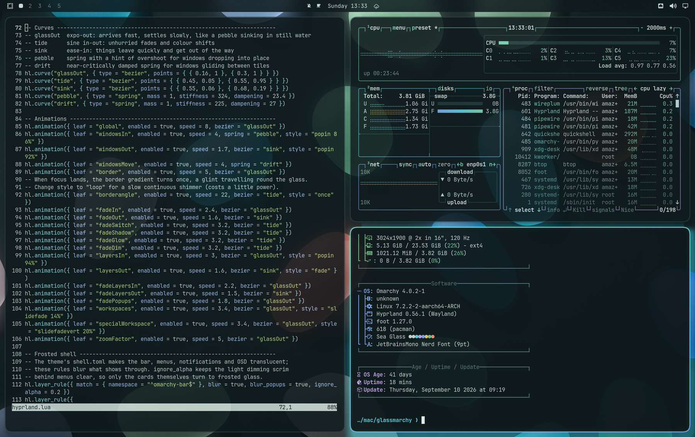

## Screenshots

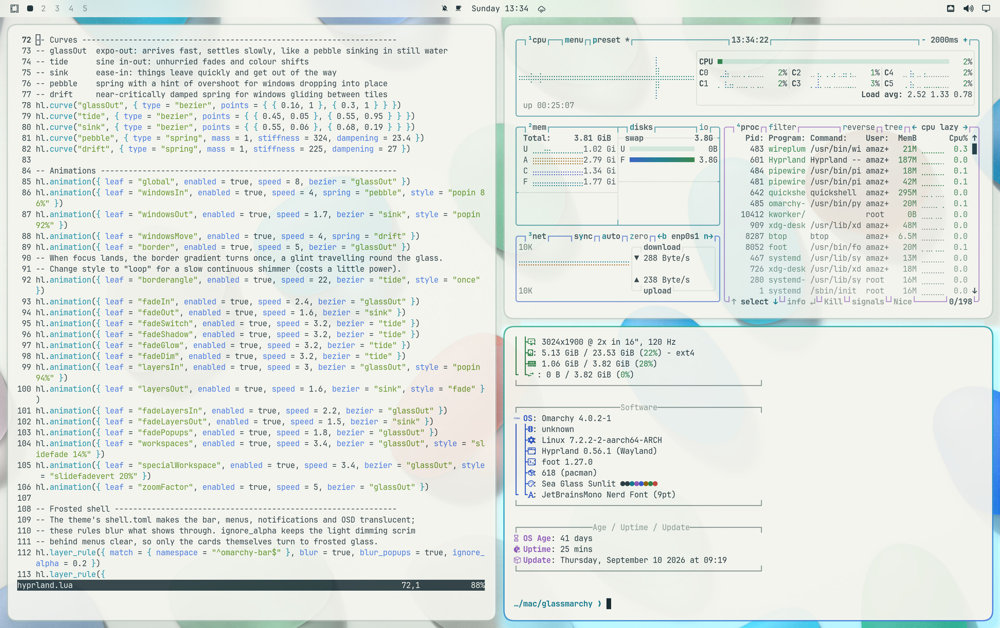

<p align="center">
  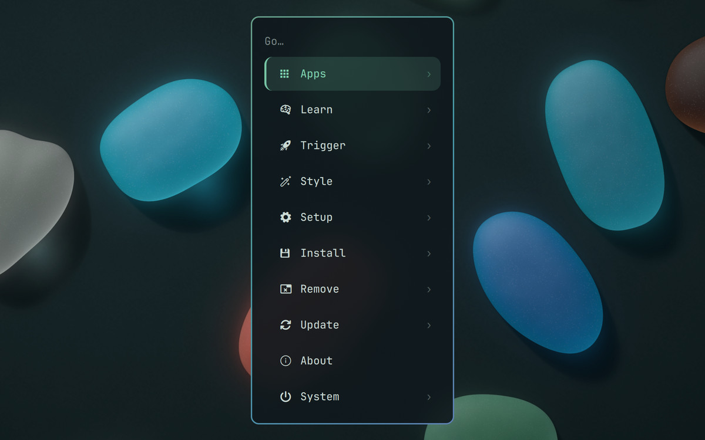
  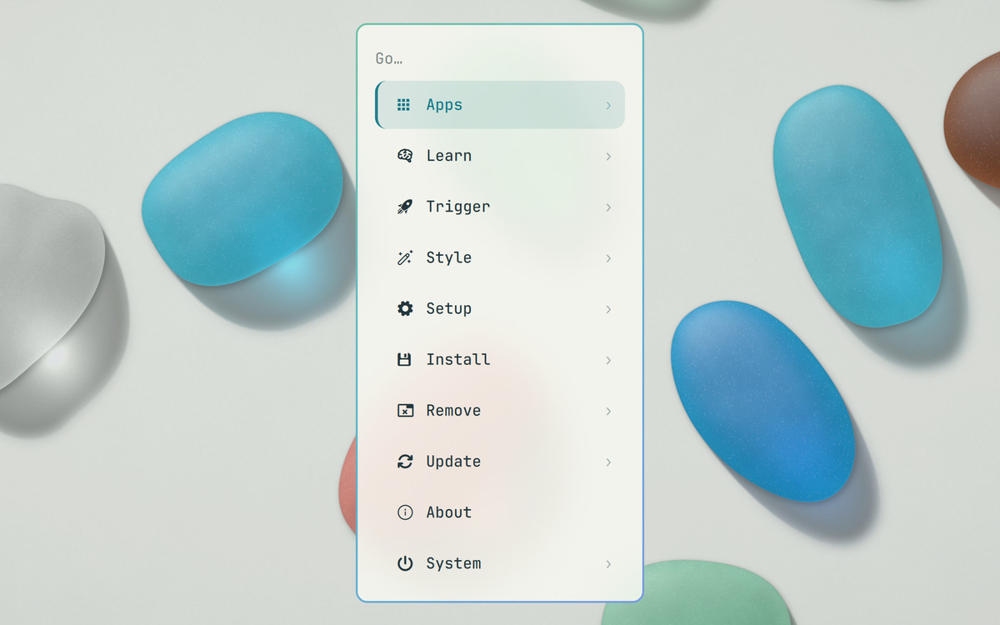
</p>
<p align="center">
  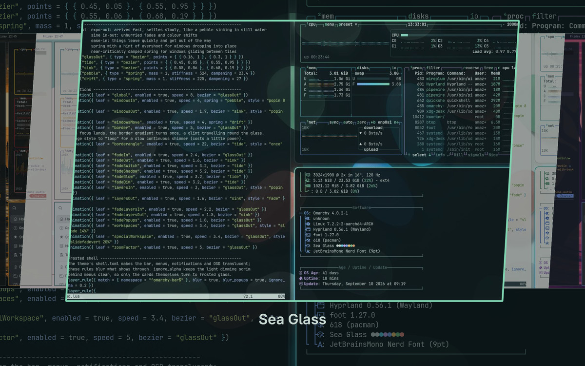
  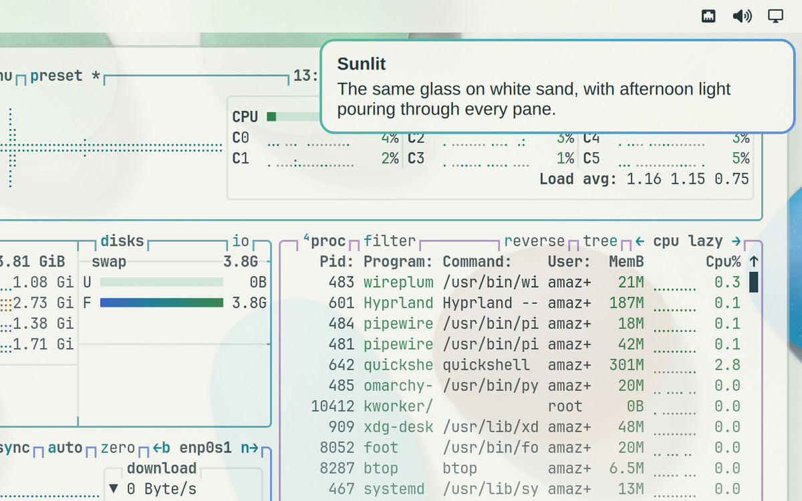
</p>

**The wallpapers on the desktop.** Three for each mood: Tide Pool on top, Sunlit below.

<p align="center">
  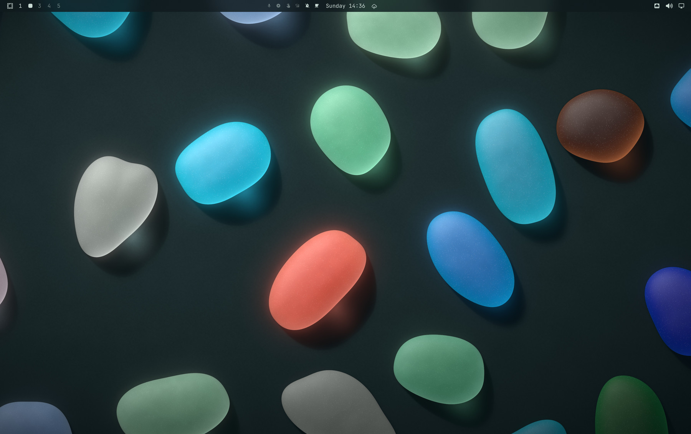
  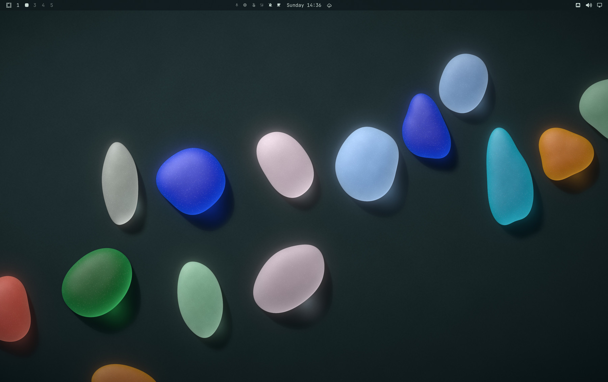
  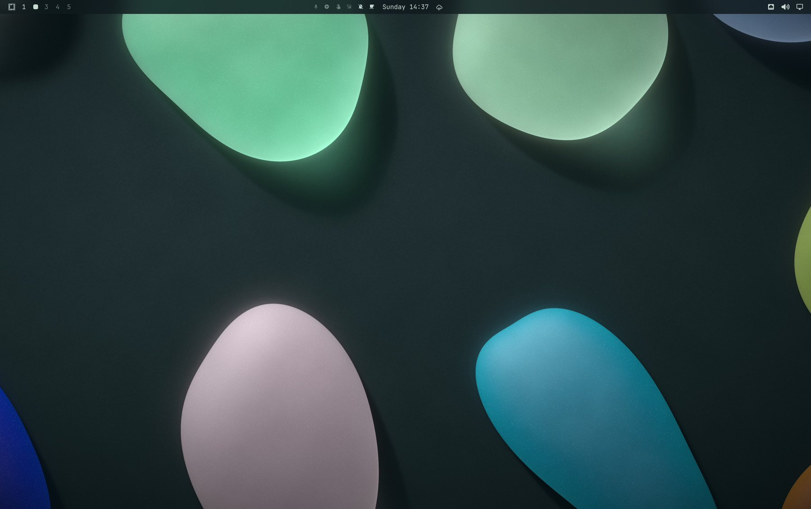
</p>
<p align="center">
  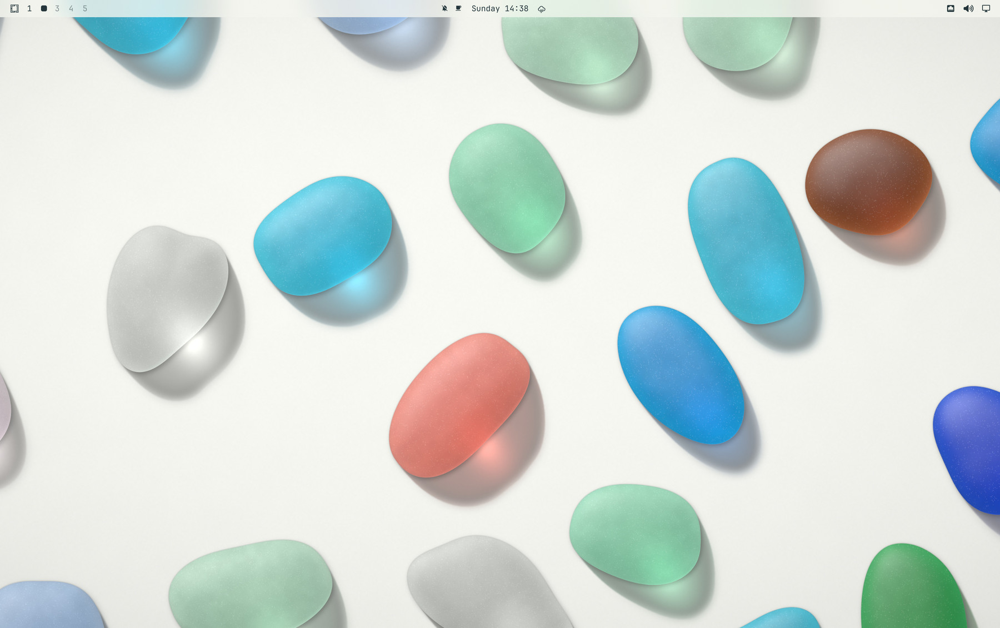
  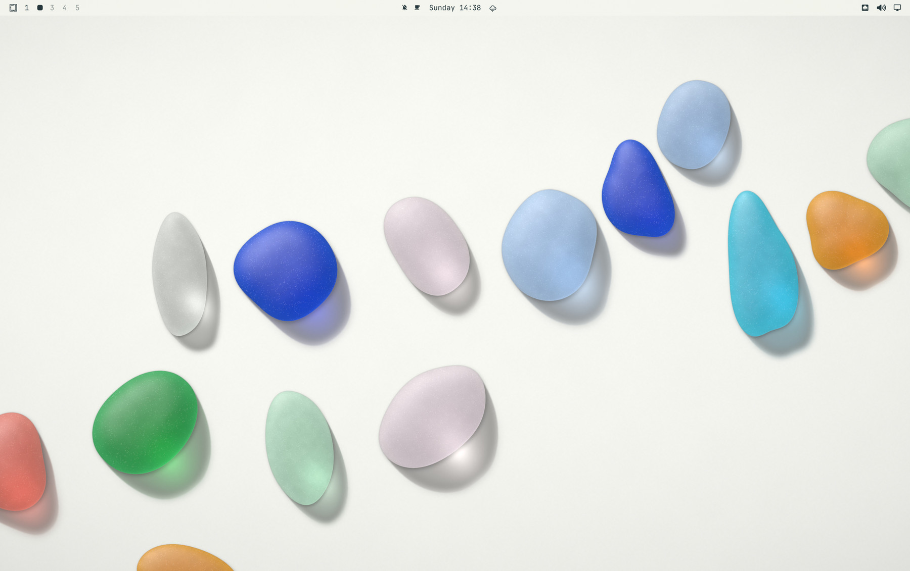
  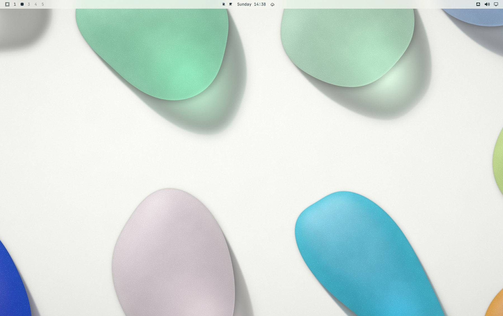
</p>

<sub>Real screenshots from Omarchy 4.0.2 with Hyprland 0.56.1, taken with <code>grim</code> in the Try Omarchy VM on a Mac (3024 × 1900 at 2×). They are resized and cropped but otherwise unedited, and the files are in <a href="screenshots">screenshots</a>.</sub>

## Install

**Full theme (recommended).** This gives you the blur, rounded corners, tinted shadows and animations.

```bash
git clone https://github.com/amazedsaint/glassmarchy
cd glassmarchy
./install.sh                 # installs both moods, switches to Tide Pool
./install.sh --set light     # or start in Sunlit
```

`install.sh` copies the two themes to `~/.config/omarchy/themes/sea-glass` and `~/.config/omarchy/themes/sea-glass-sunlit`. Omarchy applies everything in a theme you installed yourself, including `hyprland.lua`. It is plain Hyprland config, so it is worth a read before you run the script.

To update, `git pull` and run `./install.sh` again. If you installed with `--link`, the themes are symlinks to your checkout, so after a `git pull` you only need `omarchy theme set "Sea Glass"` to pick up the changes.

**Colours only.**

```bash
omarchy theme install https://github.com/amazedsaint/glassmarchy
```

When Omarchy 4 clones a theme it keeps the palette, `shell.toml`, `btop.theme`, the wallpapers and the previews. It drops every `.lua` file, so this route gives you the colours, the translucent shell styling and the gradient window borders, but none of the blur or motion. Only the dark theme installs this way, and it is named after the repo, so it shows up as **Glassmarchy**.

After installing:

| | |
|---|---|
| Switch themes | <kbd>Super</kbd> <kbd>Ctrl</kbd> <kbd>Shift</kbd> <kbd>Space</kbd>, or `omarchy theme set "Sea Glass"` |
| Pick a wallpaper | <kbd>Super</kbd> <kbd>Ctrl</kbd> <kbd>Space</kbd> |
| Boot unlock art | Omarchy menu › Style › Unlock |

If switching themes asks for your password, that is Omarchy recolouring the Chromium frame through a browser policy, which needs root. Some installs, such as the Try Omarchy VM, ask every time. Cancelling skips only the browser colour; the rest of the theme still applies.

## Motion

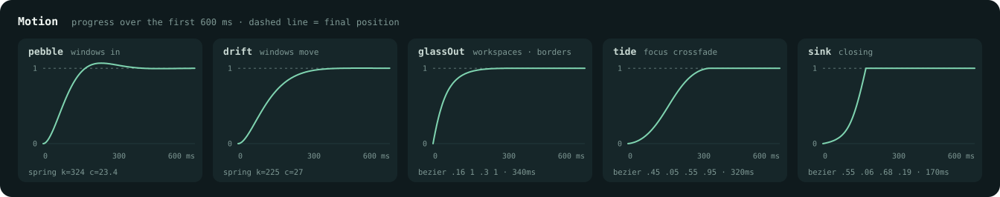

- **Windows drop in on a spring** (`pebble`, damping ratio ≈ 0.65). They pop in from 86 % scale and settle with a slight overshoot.
- **Tiles glide** on a near-critically damped spring (`drift`, ≈ 0.9), so rearranging never wobbles.
- **Focus lands with a glint.** The seafoam → turquoise → cobalt border gradient turns once around the window. Change `style = "once"` to `"loop"` for a slow continuous shimmer (costs a little power).
- **Workspaces slide and fade** 14 % with an expo-out curve. The scratchpad slides in vertically.
- **Crossfades** between active and inactive opacity, shadow and glow use a sine in-out (`tide`). Closing windows and layers leave fast (`sink`).
- **The shell is frosted glass.** Layer rules blur the bar, menus, launcher, notifications, OSD and polkit cards behind their translucent fills. Terminals sit at 94 % / 88 % opacity (95 % / 90 % in Sunlit).
- **One light source.** The sun sits upper-left in every wallpaper, so the window shadows fall down-right (`offset 6 10`) and carry a turquoise tint, like light through glass.

## Palette

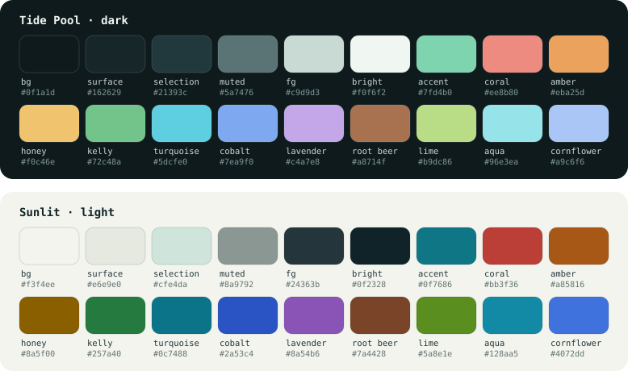

Every ANSI colour reads at **7.3 : 1 or better** on Tide Pool. On Sunlit the normal colours are at 4.7 : 1 or better and the bright ones at 3.5 : 1 or better. The palette lives in `colors.toml`, and Omarchy generates the terminal, Neovim, VS Code, Helix and Obsidian themes from it.

## Wallpapers

| Tide Pool | Sunlit |
|---|---|
| `1-tide-pool` — glass scattered on wet slate | `1-sunlit-shore` — the reference tray in afternoon sun |
| `2-moonlit-wrack` — a drift line left by the tide | `2-low-tide` — the same drift line on white sand |
| `3-night-swim` — large pieces at the edges, open centre | `3-white-sand` — large pieces at the edges, open centre |

All six are 3840 × 2160, and a rare red piece hides in the first two. They are in `backgrounds/` and `variants/sunlit/backgrounds/`, and the [screenshots](#screenshots) show each one on the desktop. To render them at another size, for example a 32:9 ultrawide, run `python3 .tools/wallpapers.py --size 5120x1440` (see [.tools](.tools/README.md)).

## What's inside

| File | Styles |
|---|---|
| `colors.toml` | the palette; Omarchy generates terminals, Neovim, VS Code, Helix, Obsidian, keyboard RGB and more from it |
| `shell.toml` | Omarchy 4 shell: frosted bar, menus, launcher, notifications, OSD, polkit, lock screen |
| `hyprland.lua` | Omarchy 4 look and motion: rounding, blur, shadow, glow, curves, animations, layer blur |
| `btop.theme` | sea glass gradients on a transparent background |
| `icons.theme`, `chromium.theme` | Yaru prussian green icons, browser frame colour |
| `preview.png` | the screenshot the theme picker shows |
| `unlock.png`, `preview-unlock.png` | boot unlock art (Style › Unlock) |
| `hyprland.conf`, `hyprlock.conf`, `waybar.css`, `walker.css`, `mako.ini`, `swayosd.css` | the same look on Omarchy 3.x |
| `variants/sunlit/` | the light theme, with the same files plus `light.mode` |
| `screenshots/` | the screenshots in this README; `install.sh` leaves them out of the installed themes |
| `.assets/`, `.tools/` | the motion and palette figures, and the scripts that generate the theme (Omarchy never installs dot-folders) |

## Compatibility and tuning

- **Omarchy 4** with Hyprland 0.55 or newer. Both moods run on Omarchy 4.0.2 with Hyprland 0.56.1 in the screenshots above, and `hyprland.lua` was checked against the option tables, animation tree and rule fields of Hyprland 0.55.0 and current main.
- **Omarchy 3.x** uses the `.conf` and `.css` files automatically. They stick to bezier curves, so windows enter with a slight bezier overshoot instead of the spring.
- **Integrated GPUs and VMs.** If blur feels heavy, lower `passes = 3` to `2` in `hyprland.lua`, or set `enabled = false` in its blur block. The colours do not depend on blur.

## Licence

MIT. See [LICENSE](LICENSE).
